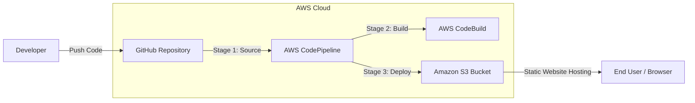

# Angular Calculator CI/CD Pipeline on AWS

A fully automated CI/CD pipeline for a Sample Angular Calculator Application. This project demonstrates how to integrate **GitHub**, **AWS CodePipeline**, **AWS CodeBuild**, and **Amazon S3** to achieve continuous integration and continuous deployment (CI/CD).

## 📖 Project Overview

This repository contains a sample Angular Calculator application created for the **Solutions Architect Path**. The primary focus of this project is the infrastructure and deployment strategy, showcasing a seamless CI/CD workflow. 

Whenever code is pushed to the `main` branch of this GitHub repository, AWS CodePipeline automatically triggers a build via AWS CodeBuild and deploys the static files to an Amazon S3 bucket configured for static website hosting.

---

## 🏗️ Architecture & CI/CD Flow

The following diagram illustrates the automated deployment pipeline:

### Pipeline Stages:
1. **Source:** AWS CodePipeline detects changes in the GitHub repository and pulls the latest code.
2. **Build:** AWS CodeBuild uses the `buildspec.yml` file to install dependencies (`npm install`) and build the Angular application for production (`ng build`).
3. **Deploy:** The compiled static artifacts are automatically deployed to the Amazon S3 bucket.

---

## 🎯 Learning Outcomes

- Understand the fundamental concepts of CI/CD.
- Create a CI/CD pipeline using AWS CodePipeline.
- Create an S3 bucket for static website deployment.
- Use **GitHub** as the version control system.
- Use AWS CodeBuild to build an Angular project.
- Use a `buildspec.yml` file.
- Integrate automated testing into CodePipeline using CodeBuild.

---

## 🛠️ Tech Stack

- **Frontend:** Angular
- **Source Control:** GitHub
- **CI/CD:** AWS CodePipeline, AWS CodeBuild
- **Hosting:** Amazon S3 (Static Website Hosting)

---

## 🚀 Features

- **Simple Calculator:** Basic arithmetic operations (+, -, *, /).
- **Automated Deployment:** Zero manual intervention required after pushing code to GitHub.
- **Version Control:** Fully managed through GitHub.

---

## 👤 Author

**Maher** — Full-Stack Developer

- 🐙 GitHub: [@DeveloperMaher](https://github.com/DeveloperMaher)
- 💼 LinkedIn: [Maher Shalash](https://www.linkedin.com/in/maher-shalash/)
- 📧 Email: [m.shalash@outlook.de](mailto:m.shalash@outlook.de)

---
